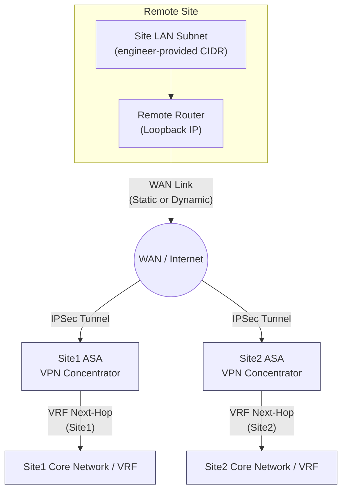
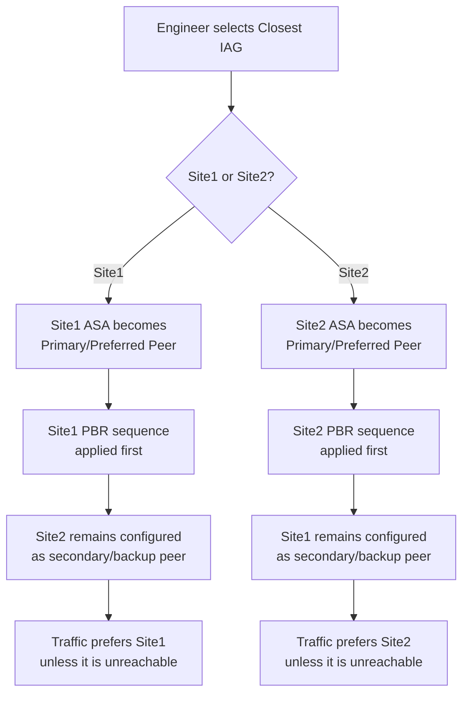
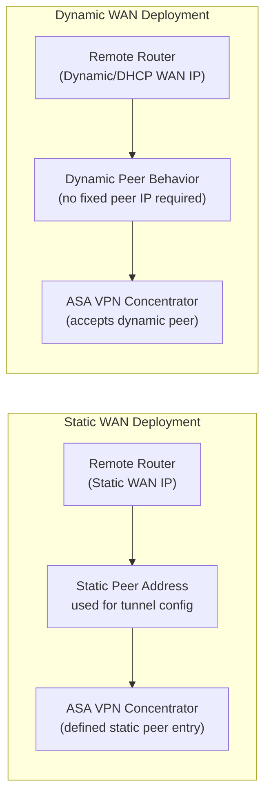

# IPSec VPN Configuration Generator

(repost)

This was a internship project I was able to tackle on during my time at L3Harris as a summer IT Security Analyst intern. I am not going to share the scripting code, IPs, exact naming schemes, outputs, etc because that contains disclosed information. But I still want to showcase the process of how I went about it for the network our program had been responsible for.

## Project Overview

The **IPSec VPN Configuration Generator** was created to automate the configuration process used during VPN site activations.

The original process required engineers to manually build or modify configuration files for:

- The **remote router**
    
- The **Site1 ASA VPN concentrator**
    
- The **Site2 ASA VPN concentrator**
    

Because these configurations follow a consistent structure, the goal was to convert the repetitive manual process into a **form-driven configuration generator**.

The engineer enters the site-specific information, and the application automatically calculates the required network values, applies the correct VRF and site-specific mappings, and generates three device-ready configuration outputs.

---

# Original Request

The project started from the following requirement:

> Our IPSec VPN process needs help automating configuration files for activations. What I’m looking for is a script or HTML page that will take input in from the engineer and generate configuration files to be applied to our VPN concentrators.
> 
> If you look at the config files in the site folders, you’ll notice they follow much of the same pattern. There’s a router config file and two VPN concentrators we have to apply configs to.
> 
> The script or webpage should accept the following data from the user:
> 
> - Site name
>     
> - Router name
>     
> - Loopback IP
>     
> - LAN subnet
>     
> - Dynamic or Static assignment
>     
>     - Static peers use the static peer addresses
>         
>     - Dynamic peers use the dynamic peer addresses
>         
> - Closest IAG
>     
>     - Site1 or Site2
>         
> - Generate a random 16-character pre-shared key
>     
> 
> This data should be combined with the rest of the configuration to form configuration files for the engineer to apply to the appropriate devices.





---

# Project Goal

The main goal of the project is to:

> **Take a small set of site-specific inputs and automatically generate standardized IPSec VPN configurations for the router and both ASA VPN concentrators.**

Instead of engineers manually copying, modifying, and validating configuration templates for every deployment, the tool handles the repetitive configuration work automatically.

This helps:

- Reduce manual configuration effort
    
- Standardize VPN deployments
    
- Reduce copy/paste errors
    
- Prevent incorrect subnet calculations
    
- Prevent incorrect next-hop assignments
    
- Prevent incorrect VLAN or VRF mappings
    
- Ensure Site1 and Site2 configurations are generated consistently
    
- Automatically create secure pre-shared keys
    
- Speed up the activation process
    

---

# What I Did

I translated the existing VPN deployment process into an automated workflow.

The work involved several major areas:

1. Identifying the information engineers need to provide
    
2. Defining the expected router configuration
    
3. Defining the expected Site1 ASA configuration
    
4. Defining the expected Site2 ASA configuration
    
5. Creating VRF-specific mapping logic
    
6. Automating subnet calculations
    
7. Adding Static vs Dynamic WAN logic
    
8. Adding Site1 vs Site2 preference logic
    
9. Automating pre-shared key generation
    
10. Validating generated configurations against expected deployment standards
    

This made the project more than a simple HTML form.

It became a **rules-based VPN configuration generation tool**.

---

# Required User Inputs

The application currently collects the site-specific values needed to build the configurations. (Though in future renditions I had definitely envisioned this too to be somewhat automated and parsed for the Security Engineers.)

## Site Information

- **Site Name / From Site**
    
- **Router Hostname**
    
- **Loopback IP**
    
- **LAN Subnet**
    

Example:

```text
Site Name: BRANCH-001
Router Hostname: BRANCH-001-RTR
Loopback IP: 10.10.10.1
LAN Subnet: 192.168.50.0/24
```

---

## WAN Information

The engineer selects the WAN assignment type:

- **Dynamic**
    
- **Static**
    

Static deployments require additional WAN information.

Depending on the WAN type, the application changes the VPN peer configuration automatically.

---

## Closest IAG

The engineer identifies which VPN concentrator location is preferred:

- **Site1**
    
- **Site2**
    

The generator uses this selection to control which peer is preferred in the resulting configuration.

---

## VRF Selection

The engineer selects the appropriate VRF.

The application uses the selected VRF to automatically determine values such as:

- VPN set
    
- ASA VLAN
    
- Site1 next-hop
    
- Site2 next-hop
    
- Other VRF-specific configuration values
    

This removes the need for the engineer to manually look up these mappings.

---

## PBR Sequence Numbers

The application supports the required Policy-Based Routing sequence values for both VPN concentrator locations.

Examples include:

- Site1 PBR sequence
    
- Site2 PBR sequence
    

These values are inserted into the appropriate route-map configuration.

---

## Pre-Shared Key

The application automatically generates a random **16-character IPSec pre-shared key**.

The generated key is then inserted consistently into all configurations that require it.

This prevents engineers from having to manually create and copy the key between configuration files.

---

# Application Workflow

The application follows the workflow below.

```text
Engineer enters site information
        |
        v
Validate input
        |
        v
Parse LAN subnet
        |
        v
Calculate network values
        |
        v
Look up VRF configuration
        |
        v
Determine Static/Dynamic WAN behavior
        |
        v
Determine preferred IAG
        |
        v
Generate pre-shared key
        |
        v
Populate router template
        |
        v
Populate Site1 ASA template
        |
        v
Populate Site2 ASA template
        |
        v
Display generated configurations
```

---

# Network Calculations

One of the important parts of the application is automatically converting the LAN CIDR entered by the engineer into the values required by the device configurations.

For example:

```text
Input:
192.168.50.0/24
```

The application calculates:

```text
Network Address:     192.168.50.0
Subnet Mask:         255.255.255.0
Wildcard Mask:       0.0.0.255
First Usable IP:     192.168.50.1
Prefix Length:       24
```

These calculated values are then used throughout the router and ASA templates.

This eliminates the need for the engineer to manually calculate subnet masks, wildcard masks, or gateway addresses.

---

# CIDR Parsing Logic

The JavaScript takes a subnet entered in CIDR notation:

```text
<network>/<prefix>
```

For example:

```text
10.20.30.0/24
```

It derives:

- Network address
    
- Prefix length
    
- Subnet mask
    
- Wildcard mask
    
- First usable LAN IP
    

The first usable IP can then be used for values such as:

```text
<LAN+1>
```

---

# VRF-Based Automation

A major part of the automation is the `VRF_TABLE`.

Instead of requiring engineers to remember or manually look up infrastructure-specific values, the application stores the mappings centrally.

Conceptually:

```javascript
VRF_TABLE = {
    VRF_NAME: {
        vpnSet: "...",
        vlan: "...",
        site1NextHop: "...",
        site2NextHop: "..."
    }
}
```

When an engineer selects a VRF, the application automatically retrieves the associated configuration values.

---

# Values Retrieved From the VRF Table

Depending on the selected VRF, the generator can retrieve:

- **VPN Set**
    
- **VLAN ID**
    
- **Site1 Next-Hop**
    
- **Site2 Next-Hop**
    

These values are then inserted into the appropriate ASA configurations.

This converts a previously manual infrastructure lookup into a deterministic rules-based process.

---

# Router Configuration Generation

The router configuration is built from the `ROUTER_TEMPLATE`.

The application takes the engineer's inputs and calculated network values and replaces placeholders inside the template.

## Router Placeholder Replacements

The router template replaces:

|Placeholder|Generated From|
|---|---|
|`<LOOPBACK>`|Engineer-provided loopback IP|
|`<HOSTNAME>`|Engineer-provided router hostname|
|`<LAN+1>`|First usable address from LAN subnet|
|`<LAN>`|Calculated LAN network address|
|`<LAN_MASK>`|Calculated subnet mask|
|`<RMASK>`|Calculated wildcard/reverse mask|
|`<SITE>`|Engineer-provided site name|
|`<KEY>`|Generated 16-character pre-shared key|

---

# Router Example

Given:

```text
Site: BRANCH-001
Hostname: BRANCH-001-RTR
Loopback: 10.10.10.1
LAN: 192.168.50.0/24
```

The generator determines:

```text
<LAN>      = 192.168.50.0
<LAN+1>    = 192.168.50.1
<LAN_MASK> = 255.255.255.0
<RMASK>    = 0.0.0.255
```

Those values are then inserted into the router configuration template automatically.

---

# ASA Configuration Generation

The ASA configuration is based on the `ASA_TEMPLATE`.

The same base structure is used to generate two separate configurations:

1. **Site1 ASA**
    
2. **Site2 ASA**
    

The application inserts site-specific next-hop, VLAN, sequence, peer, and preference information into each output.

---

# ASA Placeholder Replacements

Both Site1 and Site2 outputs replace the following values:

|Placeholder|Generated From|
|---|---|
|`<LOOPBACK>`|Engineer-provided loopback IP|
|`<LAN>`|Calculated LAN network|
|`<LAN_MASK>`|Calculated subnet mask|
|`<SITE>`|Engineer-provided site name|
|`<VLAN>`|VRF table lookup|
|`<MASK>`|Required generated network mask|
|`<NEXT-HOP>`|Site-specific VRF next-hop|
|`<SEQ>`|Site-specific PBR sequence|
|`<KEY>`|Generated pre-shared key|

---

# Site1 vs Site2 Logic

Although the ASA configurations share the same general structure, certain values must be different depending on the VPN concentrator.

For example:

```text
Site1 ASA
    -> Site1 next-hop
    -> Site1 PBR sequence
    -> Site1-specific peer behavior

Site2 ASA
    -> Site2 next-hop
    -> Site2 PBR sequence
    -> Site2-specific peer behavior
```

The generator automatically produces both versions rather than requiring the engineer to manually modify one configuration into another.

---

# Closest IAG Logic

The **Closest IAG** selection determines which site should be treated as the preferred VPN path.

The engineer selects either:

```text
Site1
```

or:

```text
Site2
```

The application uses this selection when generating the VPN configuration so the appropriate concentrator receives the preferred configuration values.

This removes another manual decision from the configuration-building process.





---

# Static vs Dynamic WAN Logic

The generator also handles differences between **Static** and **Dynamic** WAN deployments.

The engineer selects:

```text
Dynamic
```

or:

```text
Static
```

The JavaScript then adjusts the generated VPN configuration accordingly.


## Dynamic WAN

For dynamic deployments, the application uses the predefined dynamic peer behavior.

The engineer does not need to manually modify the template for the dynamic VPN case.


## Static WAN

For static deployments, additional WAN information can be supplied.

The application then uses the static peer configuration rather than the dynamic configuration.

This allows the same application to generate both deployment types without maintaining separate manual templates.





---

# Pre-Shared Key Generation

The application generates a random **16-character pre-shared key** for each VPN deployment.

Conceptually:

```text
Generate PSK
      |
      +--> Router configuration
      |
      +--> Site1 ASA configuration
      |
      +--> Site2 ASA configuration
```

The same key is inserted into all required locations so the devices have matching authentication information.

---

# Configuration Templates

The application separates the configuration structure from the engineer-provided data by using templates.

The two primary templates are:

```javascript
ROUTER_TEMPLATE
ASA_TEMPLATE
```

Instead of constructing every command independently, the application starts with standardized configurations containing placeholders.

Example:

```text
hostname <HOSTNAME>
```

The script replaces:

```text
<HOSTNAME>
```

with the value supplied by the engineer.

For example:

```text
hostname BRANCH-001-RTR
```

This pattern is repeated throughout the configuration.

---

# Configuration Components Automated

The generated configurations can include standardized configuration structures such as:

- Object groups
    
- Access lists
    
- Prefix lists
    
- Route maps
    
- Policy-Based Routing
    
- Crypto configuration
    
- IPSec parameters
    
- Tunnel groups
    
- Peer definitions
    
- LAN network definitions
    
- Loopback references
    
- Static WAN configuration
    
- Dynamic WAN configuration
    
- VRF-specific routing
    
- Site-specific next-hops
    
- VLAN assignments
    
- Pre-shared keys


---
# Example prototype of the Splashpage


---

# Output

After processing the inputs, the application generates three independent configuration outputs.

## Output 1 — Router

Contains the configuration that must be applied to the remote router.

```text
Router
```

---

## Output 2 — ASA Site1

Contains the configuration that must be applied to the Site1 VPN concentrator.

```text
ASA Site1
```

---

## Output 3 — ASA Site2

Contains the configuration that must be applied to the Site2 VPN concentrator.

```text
ASA Site2
```

The application displays these configurations in separate output tabs so the engineer can clearly identify which configuration belongs on each device.

---

# Validation and Troubleshooting

An important part of developing the generator was validating that automated mappings produced the same values expected in an actual VPN deployment.

Examples of issues identified during validation included:

- Incorrect `<NEXT-HOP>` values
    
- Incorrect VLAN assignments
    
- Incorrect prefix-list results
    
- Incorrect VRF mappings
    
- Site1 vs Site2 mapping errors
    
- Naming/mapping corrections such as **DACS being associated with DOACS**
    

These findings were important because the application is only useful if the generated configuration matches the actual network standards.

---

# Why the Validation Work Matters

The generator is performing infrastructure automation.

A configuration can be syntactically valid while still being operationally incorrect.

For example, selecting the wrong:

```text
<NEXT-HOP>
```

could result in traffic being routed incorrectly.

Similarly, selecting the wrong:

```text
<VLAN>
```

or prefix-list value could cause the generated configuration to fail even though the template itself is valid.

Because of this, development included more than simply making the page generate text.

It also required understanding and validating the expected network relationships.

---

# My Role in the Project

My contribution can be summarized as turning the existing VPN provisioning process into a repeatable automation workflow.

## 1. Defined the Required Inputs

I identified the information an engineer needs to provide for each deployment:

- Site name
    
- Router hostname
    
- Loopback IP
    
- LAN subnet
    
- WAN assignment
    
- Closest IAG
    
- VRF
    
- PBR sequence information
    
- Static WAN information when applicable
    

---

## 2. Defined the Expected Outputs

I established the configuration structure required for:

- The router
    
- Site1 ASA
    
- Site2 ASA
    

This included identifying which configuration fields change between deployments and which remain standardized.

---

## 3. Defined Template Variables

I converted the changing portions of the configurations into placeholders such as:

```text
<HOSTNAME>
<LOOPBACK>
<LAN>
<LAN+1>
<LAN_MASK>
<RMASK>
<SITE>
<VLAN>
<NEXT-HOP>
<SEQ>
<KEY>
```

This made it possible to reuse standard configuration templates for every site.

---

## 4. Automated Network Calculations

I incorporated logic to automatically derive the network information needed by the configuration.

This included:

```text
CIDR
  |
  +--> Network address
  +--> Subnet mask
  +--> Wildcard mask
  +--> First usable address
  +--> Prefix length
```

This removed subnet calculation from the engineer's manual workflow.

---

## 5. Automated VRF Mappings

I incorporated a centralized VRF mapping table so that infrastructure-specific values could be selected automatically.

This includes relationships between:

```text
VRF
 |
 +--> VPN Set
 +--> ASA VLAN
 +--> Site1 Next-Hop
 +--> Site2 Next-Hop
```

---

## 6. Added Static and Dynamic WAN Rules

I added logic allowing the same generator to support multiple VPN deployment types.

```text
WAN Type
   |
   +--> Static
   |
   +--> Dynamic
```

The correct peer behavior is selected automatically based on the engineer's choice.

---

## 7. Added Site Preference Logic

I added support for selecting the closest IAG:

```text
Closest IAG
   |
   +--> Site1
   |
   +--> Site2
```

The generated configuration can then reflect the appropriate peer preference.

---

## 8. Automated Pre-Shared Keys

I added random 16-character pre-shared key generation.

Rather than requiring the engineer to create and manually synchronize the key between devices, the tool generates it once and inserts it into all required configurations.

---

## 9. Generated Multiple Device Configurations

I designed the workflow so one set of engineer inputs produces all three required outputs:

```text
                  User Input
                      |
          +-----------+-----------+
          |           |           |
          v           v           v
       Router      ASA Site1   ASA Site2
       Config       Config      Config
```

---

## 10. Tested the Generated Results

I validated that the output matched the expected network deployment standards.

This included checking:

- Correct VRF relationships
    
- Correct next-hop values
    
- Correct VLAN values
    
- Correct prefix-list values
    
- Correct PBR sequence values
    
- Correct Site1/Site2 differences
    
- Correct Static/Dynamic behavior
    
- Correct template replacements
    

This testing exposed mapping issues that could then be corrected before engineers relied on the generated configurations.

---

# Technical Architecture

At a high level, the application works as follows:

```text
HTML
 |
 +--> Engineer Input Form
 |
JavaScript
 |
 +--> Input Validation
 +--> CIDR Parsing
 +--> Network Calculations
 +--> VRF Lookup
 +--> WAN Logic
 +--> IAG Preference Logic
 +--> PSK Generation
 +--> Template Replacement
 |
Templates
 |
 +--> ROUTER_TEMPLATE
 +--> ASA_TEMPLATE
 |
Generated Output
 |
 +--> Router
 +--> ASA Site1
 +--> ASA Site2
```

---

# Why This Is More Than a Form

The HTML form is only the user interface.

The important part of the project is the logic behind it.

The generator encodes operational rules such as:

```text
If VRF = X
    use VLAN Y
    use Site1 next-hop Z
    use Site2 next-hop A
```

and:

```text
If WAN = Static
    use static peer behavior
else
    use dynamic peer behavior
```

and:

```text
If Closest IAG = Site1
    prefer Site1
else
    prefer Site2
```

This means the application acts as a small **configuration rules engine**, not just a text replacement utility.

---

# Before Automation

The original workflow required an engineer to:

```text
Find an existing configuration
        |
Copy the configuration
        |
Change the hostname
        |
Change site information
        |
Calculate subnet values
        |
Find VRF mappings
        |
Find VLAN
        |
Find next-hop
        |
Configure Site1 values
        |
Configure Site2 values
        |
Create PSK
        |
Update router config
        |
Update ASA Site1 config
        |
Update ASA Site2 config
        |
Manually verify everything
```

Every manual step introduced an opportunity for error.

---

# After Automation

The automated workflow becomes:

```text
Enter site information
        |
Select WAN type
        |
Select IAG
        |
Select VRF
        |
Generate
        |
+--------------------------+
| Router Configuration     |
| ASA Site1 Configuration  |
| ASA Site2 Configuration  |
+--------------------------+
```

The engineer can focus on validating and applying the configuration rather than manually constructing it.

---

# Key Benefits

## Consistency

Every VPN deployment follows the same configuration template.

## Speed

Engineers no longer need to manually create three configuration files for each activation.

## Accuracy

Subnet calculations and known mappings are performed programmatically.

## Standardization

Router and VPN concentrator configurations follow an established deployment standard.

## Maintainability

Infrastructure mappings can be updated centrally in the application's lookup tables instead of requiring every engineer to remember the changes.

## Reduced Human Error

Common mistakes such as incorrect:

- VLANs
    
- Next-hops
    
- Masks
    
- Wildcard masks
    
- Prefix lists
    
- PBR sequences
    
- Peer selections
    
- Pre-shared keys
    

can be reduced through automation.

---

# Project Summary

### Project Goal

Build a web-based tool that automatically generates standardized IPSec VPN configurations for:

- A remote router
    
- A Site1 ASA VPN concentrator
    
- A Site2 ASA VPN concentrator
    

using a small set of site-specific inputs.

### What I Implemented

I converted the manual VPN provisioning process into a form-driven automation workflow by defining and implementing:

- Required engineer inputs
    
- Router configuration templates
    
- ASA configuration templates
    
- Site1/Site2 configuration differences
    
- CIDR and subnet calculations
    
- VRF lookup rules
    
- VLAN mappings
    
- Next-hop mappings
    
- Prefix-list/PBR information
    
- Static vs Dynamic WAN behavior
    
- Closest-IAG preference logic
    
- Random pre-shared key generation
    
- Three separate configuration outputs
    
- Configuration validation against expected network standards
    

### Result

The finished application takes this:

```text
Site Information
+
Network Information
+
VRF
+
WAN Type
+
Closest IAG
```

and automatically produces:

```text
Router Configuration
+
ASA Site1 Configuration
+
ASA Site2 Configuration
```


## Takeaway

In practical terms:

> **I took a repetitive manual IPSec VPN activation process and converted it into a standardized rules-based configuration generator that calculates network values, applies infrastructure mappings, and produces the three configurations required for deployment.**
